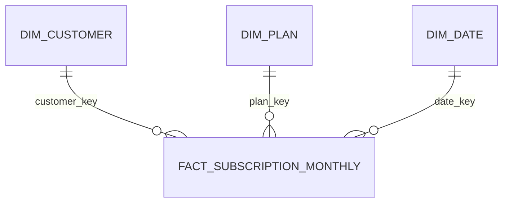

# Subscription Analytics Data Warehouse

An end-to-end data engineering project: raw subscription data goes in one end, and a validated PostgreSQL star schema, a library of analytical SQL, and a live dashboard come out the other.

The business is a fictional streaming platform with three plans (Basic ₹199, Standard ₹399, Premium ₹599 per month). Customers join, renew, upgrade, downgrade and cancel. The goal is to answer the questions a subscription business actually asks: how many people are subscribed, how much recurring revenue do we make, who is leaving and when, and which plan pays the bills.


## What this project covers

- Generating a realistic subscription history with Python, including deliberately messy data
- An ETL step in Pandas that validates, cleans and rejects bad rows, and keeps a record of every rejection
- A normalized PostgreSQL database (primary keys, foreign keys, CHECK constraints, a partial unique index)
- A dimensional model: one fact table and three dimensions, with surrogate keys and a clearly stated grain
- Analytical SQL for MRR, active subscribers, churn, retention cohorts and revenue by plan
- A validation layer that proves the warehouse agrees with the source data
- A Streamlit dashboard on top of the warehouse

## How it fits together

```
Python generator -> raw CSVs -> Pandas ETL -> clean CSVs
                                                  |
                                                  v
                          PostgreSQL  ops schema (normalized)
                                                  |
                                                  v
                          PostgreSQL  dw schema (star schema)
                                                  |
                                   +--------------+--------------+
                                   v                             v
                           Analytical SQL                  Validation checks
                                   |
                                   v
                           Streamlit dashboard
```

| Step | What happens | Code |
|---|---|---|
| 1 | Generate customers, plans, transactions and subscription history, then inject bad rows | `src/generate_data.py` |
| 2-3 | Check mandatory columns, remove duplicates, verify foreign keys and dates, standardise formats | `src/etl_clean.py` |
| 4 | Create and load the normalized `ops` tables | `src/load_operational.py`, `sql/01_*.sql` |
| 5 | Build `dim_date`, then the dimensions, then the fact table | `src/build_warehouse.py`, `sql/02_*.sql`, `sql/03_*.sql` |
| 6 | Run the analytical queries and save the results | `src/run_analytics.py`, `sql/04_*.sql` |
| 7 | Validate everything | `src/validate.py`, `sql/05_*.sql` |

## The data

With the default settings the generator produces 5,000 customers over 22 months (January 2025 to October 2026): about 6,000 subscriptions and about 36,000 payments.

Real source data is never clean, so the raw files are not either. The generator adds duplicate transaction IDs, payments pointing at customers and plans that don't exist, missing and negative amounts, subscriptions that end before they start, rows with a missing customer ID, and customer regions that are blank or badly formatted.

The ETL deals with each of these. Rows it cannot trust are written to `data/rejects/` with a `reject_reason` column. Fixable problems (blank or inconsistent regions) are repaired and counted. On the default run, 185 of about 36,500 raw transactions and 15 subscription rows are rejected, and what remains matches the original uncorrupted data exactly.

## Database design

### Operational schema (`ops`)

Four normalized tables: `customers`, `plans`, `subscriptions` and `transactions`. Prices live only in `plans` and region only in `customers`, so nothing is repeated across rows (see `docs/schema.md` for the 1NF to 3NF walkthrough).

The database enforces the business rules itself, not just the Python code:

- amounts and prices must be positive
- `end_date` must be after `start_date`
- status must be consistent with `end_date` (an ACTIVE subscription has no end date)
- a customer can have at most one ACTIVE subscription, enforced with a partial unique index

One deliberate exception to normalization: `transactions.amount` is stored even though it usually equals the plan price. A payment is history. If a price changes next year, last year's payments shouldn't.

### Star schema (`dw`)



**Grain: one row per subscription per calendar month.**

| Column | Meaning |
|---|---|
| `monthly_revenue` | Amount billed in that month |
| `active_flag` | 1 if the subscription is active on the last day of the month |
| `churn_flag` | 1 if it was cancelled during the month |
| `new_flag` | 1 if it started that month as a brand-new customer |
| `upgrade_flag`, `downgrade_flag` | 1 if it started that month as a plan change |

The dimensions use generated surrogate keys, with the original IDs kept as unique business keys. `dim_date` is a month dimension (month, quarter, year, plus a running month index that makes cohort arithmetic simple).

## Business rules and metric definitions

A warehouse is only as trustworthy as its definitions, so they are written down (in full in `docs/metric_definitions.md`). The short version:

- Billing is by calendar month at full plan price, with no proration. A customer is charged on their start date and then on the 1st of each following month.
- Plan changes take effect on the 1st of a month. The old subscription closes and a new one opens the same day.
- Cancellations happen mid-month and are not refunded. A customer never cancels in the month they joined.
- Active subscribers are subscriptions active on the last day of the month.
- MRR is the price of everything active at month end. Billed revenue is the cash actually billed in the month. They differ slightly because someone who cancels on the 15th has paid for the month but isn't active at the end of it.
- Churn rate is cancellations in the month divided by active subscribers at the end of the previous month.
- Customer churn and subscription churn are reported separately. Gross subscription churn also counts upgrades and downgrades, since each one closes a subscription.
- Retention is cohort-based: of the customers who first subscribed in a given month, what share are still active N months later.

Not modelled in this version: failed payments, refunds, free trials, and customers who come back after cancelling.

## Analytical queries

All queries live in `sql/04_analytics_queries.sql`. Each starts with a `-- name:` line, which is how the Python runner and the dashboard pick them up.

| Business question | Query |
|---|---|
| How many customers have active subscriptions? | `active_subscribers_monthly`, `active_by_plan_region_latest` |
| How much recurring revenue per month? | `revenue_monthly` |
| How many customers cancel, and what is the churn rate? | `subscriber_rollforward`, `churn_customer_vs_subscription` |
| Which plan earns the most? | `revenue_by_plan_total`, `revenue_by_plan_monthly` |
| How many new customers per month? | `new_customers_monthly` |
| How many customers stay subscribed over time? | `cohort_retention` |
| Which months have the most cancellations? | `top_cancellation_months` |
| How many upgrades and downgrades? | `plan_changes_monthly` |

They use CTEs, window functions (`LAG`, `RANK`, `SUM() OVER`) and conditional aggregation.

## Validation

`python -m src.validate` runs three layers of checks and writes `outputs/validation_report.md`.

1. **Fourteen SQL checks** that each return a count of problems (zero means pass): orphan foreign keys, duplicate IDs, duplicate fact grain, every subscription present in the fact table, non-empty tables, and more.
2. **Reconciliation against the source.** Warehouse revenue is compared with the sum of raw transaction amounts for every month. Active counts and cancellations are recomputed directly from `ops.subscriptions` and compared.
3. **An independent recomputation in Pandas** straight from the clean CSVs, compared with what the warehouse queries return.

The most useful single check is the roll-forward identity: in every month, ending subscribers must equal beginning subscribers plus new minus cancelled. It catches a surprising number of subtle mistakes.

The checks also guard against passing on an empty database. An early version of the test harness did exactly that, which is why there are now explicit "not empty" checks.

## Results

From the default dataset (5,000 customers, seed 42):

- Active subscribers grow steadily to 3,011 by October 2026
- Billed revenue reaches about ₹1.27M a month; month-end MRR is about ₹1.20M
- Monthly churn starts high (10 to 13 percent in early 2025, when the base was tiny and new customers are the riskiest) and settles at around 5 to 7 percent
- Premium generates the most revenue (44 percent of the total), followed by Standard (37 percent) and Basic (19 percent)
- Cohort retention shows the expected decay, and the empty lower-right triangle of the heatmap is correct: recent cohorts haven't had time to age


## Running it

Developed and tested on Windows with Python 3.13 and PostgreSQL 16.

### Requirements

- Python 3.10 to 3.13 (very new Python releases may not have prebuilt packages yet)
- PostgreSQL 14 or newer, running locally
- The packages in `requirements.txt`: pandas, SQLAlchemy, psycopg2-binary, python-dotenv, streamlit, plotly, pytest

### Setup

```powershell
py -3.13 -m venv .venv
.venv\Scripts\Activate.ps1
python -m pip install -r requirements.txt
copy .env.example .env
```

If PowerShell blocks the activation script, run `Set-ExecutionPolicy -Scope Process Bypass` first.

Open `.env` and set `PG_PASSWORD` to your PostgreSQL password. If something else already uses port 5432 on your machine, set `PG_PORT` to whatever port your PostgreSQL uses.

You do not need to create the database yourself. The pipeline creates `subscription_dwh` if it doesn't exist.

### Run

```powershell
python run_pipeline.py                  # all seven steps
streamlit run dashboard/app.py          # dashboard on http://localhost:8501
pytest -q                               # unit tests, no database needed
```

Options: `--customers 10000` for a bigger dataset, `--skip-generate` to reuse the CSVs already in `data/raw/`.

Each step can also be run on its own:

```powershell
python -m src.generate_data
python -m src.etl_clean
python -m src.load_operational
python -m src.build_warehouse
python -m src.run_analytics
python -m src.validate
```

### What gets produced

| Output | Location |
|---|---|
| Raw and clean CSVs | `data/raw/`, `data/clean/` |
| Rejected rows with reasons | `data/rejects/` |
| ETL report | `outputs/etl_report.json` |
| Every query result as CSV | `outputs/analytics/` |
| Validation report | `outputs/validation_report.md` |
| Database `subscription_dwh` with schemas `ops` and `dw` | PostgreSQL |

## Project structure

```
subscription-dwh/
├── run_pipeline.py
├── requirements.txt
├── .env.example
├── src/
│   ├── config.py              settings, paths, plans, date range
│   ├── db.py                  connections, running .sql files, named queries
│   ├── generate_data.py
│   ├── etl_clean.py
│   ├── load_operational.py
│   ├── build_warehouse.py
│   ├── run_analytics.py
│   └── validate.py
├── sql/
│   ├── 01_operational_schema.sql
│   ├── 02_warehouse_schema.sql
│   ├── 03_load_warehouse.sql
│   ├── 04_analytics_queries.sql
│   └── 05_validation_checks.sql
├── dashboard/app.py
├── tests/
└── docs/
    ├── schema.md
    ├── metric_definitions.md
    └── images/
```

## Decisions worth explaining

**Why a month-grain fact table?** Every question here is a monthly question, and a subscription is naturally a thing that exists across months. One row per subscription per month keeps churn, active counts and revenue as simple sums, and makes cohort retention a self-join on the month index.

**Why is the dashboard driven by the same named queries as the CSV exports?** So the numbers cannot drift apart. There is one definition of each metric, in one SQL file.

**Why are the SQL files free of percent signs and Postgres-only casts?** The runner executes raw SQL through psycopg2, which treats `%` specially. Avoiding it, and using `CAST` instead of `::`, also kept the queries portable enough to test the same files against SQLite during development.

**Why inject bad data on purpose?** An ETL that only ever sees clean input hasn't been tested. Because every bad row is added on top of a known-good dataset, the cleaned output can be compared with the original to prove nothing valid was dropped and nothing invalid got through.

## Limitations and next steps

- Dimensions are Type 1 (current values only). Tracking history, for example when a customer changes region, would need Type 2 slowly changing dimensions.
- No reactivations, trials, refunds or failed payments, so customer churn and subscription churn only differ through plan changes.
- The ETL reloads everything on each run. An incremental load keyed on transaction date would be the natural next step.
- Scheduling with Airflow or cron, and moving the validation checks into a framework such as Great Expectations, would suit a production setup.

## Documentation

- `docs/schema.md`: normalization walkthrough and ER diagrams for both schemas
- `docs/metric_definitions.md`: every metric, rule and assumption in detail
