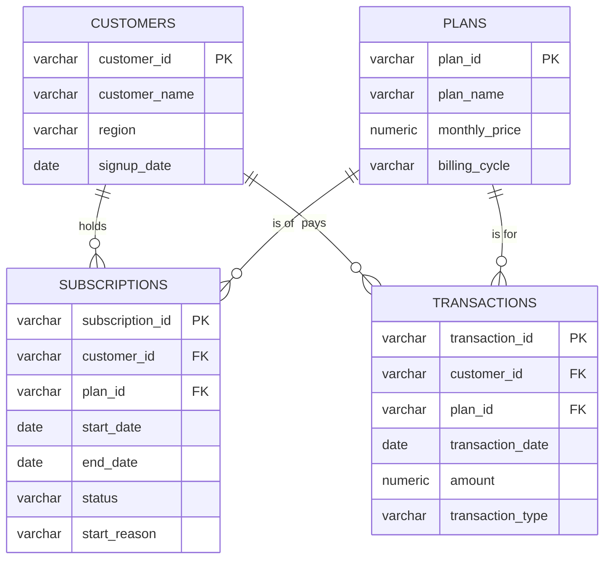
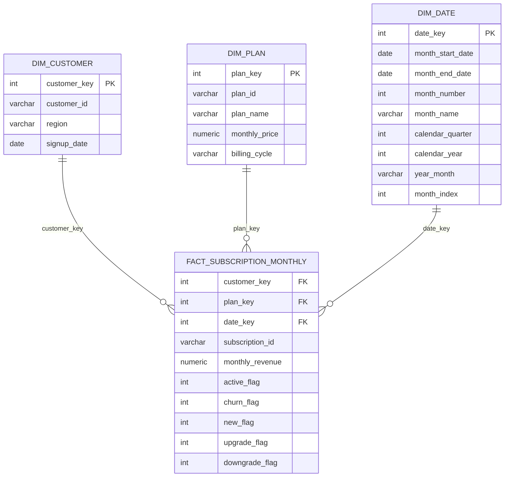

# Schema documentation

## 1. Normalization (why the operational tables look the way they do)

Starting point (one flat table, from the project brief):

| Customer | Plan | Price | Region | Transaction |
|---|---|---|---|---|
| A | Basic | 199 | India | T001 |
| A | Basic | 199 | India | T002 |
| B | Premium | 599 | USA | T003 |

* **1NF** - every column holds one atomic value, every row is identifiable (primary keys: `customer_id`, `plan_id`, `subscription_id`, `transaction_id`).
* **2NF** - attributes depend on the *whole* key. Price depends only on the plan and region only on the customer, so they move to `plans` and `customers` instead of repeating on every transaction row.
* **3NF** - no attribute depends on another non-key attribute. Plan name and price are not stored in `subscriptions`; they are reached through `plan_id`.
* **Deliberate exception:** `transactions.amount` is stored even though it usually equals the plan price. A payment is a historical fact; if the price changes tomorrow, yesterday's payment must not change. The ETL verifies amount = price for this version.

## 2. Operational schema `ops` (PostgreSQL)

Constraints: primary keys, foreign keys, `CHECK` constraints (positive prices/amounts, valid status values, `end_date > start_date`, status consistent with `end_date`), and a partial unique index allowing only one ACTIVE subscription per customer.

`subscription_history.csv` is loaded into `ops.subscriptions`. The extra column `start_reason` (NEW / UPGRADE / DOWNGRADE) was added to the brief's layout so the warehouse can tell a new customer from a plan change.

## 3. Star schema `dw`

* **Grain:** one row per subscription per calendar month.
* **Surrogate keys:** `customer_key`, `plan_key`, `date_key` are generated identity integers; the original ids are kept as business keys with a UNIQUE constraint.
* **Degenerate dimension:** `subscription_id` lives directly in the fact table; primary key = (`subscription_id`, `date_key`).
* **Dimension type:** Type-1 (current values only; no history of attribute changes).
* **Load order:** dimensions first, then the fact table (`sql/03_load_warehouse.sql`).
